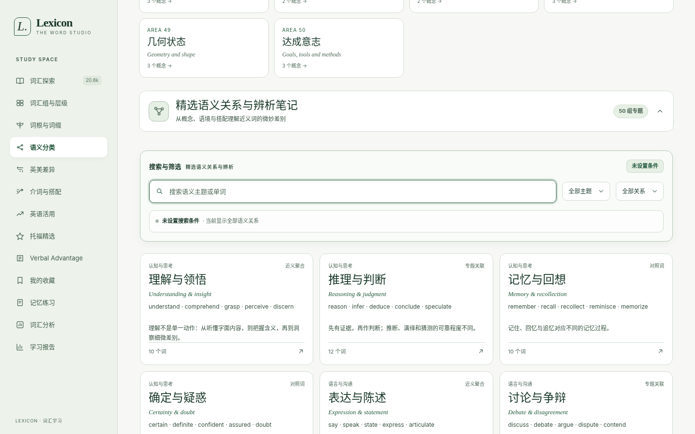

# Lexicon

**A vocabulary learning studio for English learners.** Explore word meanings in context, compare British and American English, study word roots and collocations, and review vocabulary with local progress tracking.

Lexicon is a browser-based, Chinese-language learning application that can be installed as a Progressive Web App (PWA). The core vocabulary and learning interface work offline after the initial cache has been installed.



*Semantic search with consistent focus indication and active-filter feedback.*

## Features

- **Vocabulary explorer** — Browse and search 20,821 entries, with Chinese and English explanations, example sentences and learning-level filters.
- **Meaning and usage** — Explore semantic groups, nuanced meanings, word relationships, prepositions and common collocations.
- **British and American English** — Compare 422 curated spelling, vocabulary, meaning and usage differences with contextual notes.
- **Word formation** — Investigate roots, prefixes, suffixes and related words.
- **Practice and progress** — Flashcards, review tools, saved words and local learning statistics.
- **Unified search** — Visible active-filter chips, individual filter removal, and consistent keyboard-focus styling throughout the app.
- **Installable PWA** — A home-screen / desktop app with versioned offline caching, responsive layouts and light/dark themes.

> The bundled word bank is a learning resource, not a substitute for a fully reviewed commercial dictionary. Some audio, online dictionaries and web fonts require an internet connection.

## Getting started

### Windows (no developer tools required)

1. Download and **extract the entire Windows release archive**. Do not run the executable from inside the ZIP.
2. Run `Lexicon-Start.exe` next to `index.html`.
3. Open <http://127.0.0.1:8765/> if the browser does not open automatically.
4. Once the status reads **离线词库已就绪** (“offline word bank ready”), select **安装应用** or use Chrome/Edge's app-install menu.

The launcher binds to `127.0.0.1` only. It does not upload dictionary data or learning progress. Keep the launcher running when you need to serve new files; once offline caching is complete, the installed app can work from the browser cache without the server.

### Linux and macOS

Serve the **full project directory**, not just the HTML file:

```bash
cd Lexicon-v29-PWA
python3 -m http.server 8765 --bind 127.0.0.1
```

Open <http://127.0.0.1:8765/>. A local Python 3 installation is only needed for this launch method; it is not a runtime dependency of the application itself.

Alternatively, build the minimal Go launcher (see [Building the local launcher](#building-the-local-launcher)).

### Android and iOS

Host the full web directory over HTTPS, visit its URL in the device browser, then use **Install app** (Chrome/Android) or **Share → Add to Home Screen** (Safari/iOS). Regular LAN HTTP addresses such as `http://192.168.x.x` are not normally installable PWA origins.

### Standalone HTML

`Lexicon-v29-Standalone.html` is available as a separate single-file download for direct local browsing. It contains the word bank, but **does not support PWA installation or Service Worker caching** when opened as a `file://` URL.

## Development

The web application is written in HTML, CSS and vanilla JavaScript. The local launcher uses **Go's standard library**; no frontend build tool, framework or Node.js package installation is required to serve the checked-in web files.

```bash
# Clone or download this repository, then from its root:
python3 -m http.server 8765 --bind 127.0.0.1
# Open http://127.0.0.1:8765/
```

The Python server is for local development. For deployment, use any HTTPS static host configured to serve the web assets with appropriate MIME types.

### Repository structure

```text
.
├── index.html                 # Web application and interface
├── manifest.webmanifest       # PWA metadata and icons
├── sw.js                      # Versioned offline cache and update handling
├── data/
│   ├── words-v28.json.gz     # Compressed offline vocabulary data
│   └── regional-differences-v28.json
├── icons/                     # App icons (including maskable icons)
├── docs/screenshots/          # Screenshots for the repository README
├── Lexicon-Start.go           # Optional localhost-only HTTP launcher
├── Start-Lexicon-Linux-Mac.sh # Convenience script
└── README.md
```

The data assets retain their `v28` filenames in this release because their contents are unchanged. The `v29` Service Worker cache name is updated to ensure the new UI replaces previously cached versions.

### Building the local launcher

Requires a supported Go compiler. From the repository root:

```bash
# Your own platform
go build -o Lexicon-Start Lexicon-Start.go

# Cross-compile for Windows x64 (from Linux or macOS)
GOOS=windows GOARCH=amd64 CGO_ENABLED=0 go build -o Lexicon-Start.exe Lexicon-Start.go
```

Place the compiled executable in the **same directory as `index.html`**. The server accepts `-port` (default `8765`) and `-no-browser`. For example:

```bash
./Lexicon-Start -port 8765 -no-browser
```

Use a stable port: changing ports changes the browser origin, which means local learning records will not automatically appear at the new address.

## Offline support and updates

The Service Worker precaches the application shell, manifest, icons and compressed vocabulary data. **Wait for the ready status after first opening the app online**. Future visits can load the cached shell and word bank while offline. The application does not intentionally cache responses from external dictionary, speech or font services.

When deploying a new version, update the `CACHE` name in `sw.js` (and its core file list if asset names change). The app can then detect an updated Service Worker and prompt the user to refresh. To avoid broken cache installs, publish the complete new asset set together.

For a static server, serve:

| Path | Recommended Content-Type |
| --- | --- |
| `index.html` | `text/html; charset=utf-8` |
| `sw.js` | `text/javascript; charset=utf-8` |
| `manifest.webmanifest` | `application/manifest+json` |
| `data/*.json.gz` | `application/gzip` |

Do not transparently decompress `words-v28.json.gz` while still sending a gzip-file MIME type: the app explicitly decompresses these bytes itself.

## Data, privacy and backups

- Learning records, saved words and preferences are stored in the **browser's local storage** on the current origin. There is no cross-device synchronization by default.
- `file://`, `http://127.0.0.1:8765`, another port, and an HTTPS deployment are **separate origins** with separate storage.
- To migrate from an older version or move devices, use **学习报告 → 导出** in the old app and then import the record in the new app.
- Browser storage may be cleared by users, browser settings or storage pressure. Export backups regularly.
- On-device study data and the bundled word bank do not require a remote account. Optional online services are not part of the offline cache.

## Accessibility and compatibility

The interface supports keyboard focus indicators, responsive layouts, active-filter summaries, reduced-motion preferences and light/dark themes. Chrome and Edge are the primary desktop browsers for PWA installation. Browser-specific installation behaviour may vary across platforms.

## Troubleshooting

| Issue | Suggested fix |
| --- | --- |
| Install button only shows instructions | Open from HTTPS or localhost in a PWA-capable browser; `file://` cannot install. |
| Vocabulary does not load | Check that `data/words-v28.json.gz` exists alongside the app and is served unchanged. |
| App not available offline | Open online once, then wait for the **离线词库已就绪** status before disconnecting. |
| Launcher says port is in use | Stop the existing server on 8765 or choose another port; note that saved browser records are origin-specific. |
| Previous progress is missing | Import a progress export from the original browser origin. |
| Fonts or speech change offline | External fonts, dictionary services and some voices are network-dependent. |

## Contributing and data attribution

Suggestions, bug reports and corrections to usage examples are welcome. When reporting a language issue, include the word, target sense, regional usage and a reliable dictionary reference; regional forms should not be presented as absolute rules when both are valid.

The distribution includes bundled word data and third-party dictionary-related content. **No blanket license is claimed here for upstream dictionary material.** Review the original sources and their terms before redistributing datasets or publishing a public mirror. If you publish a public repository, add an explicit project license and complete attribution for any third-party materials you are authorized to distribute.
